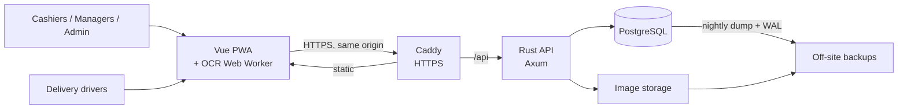
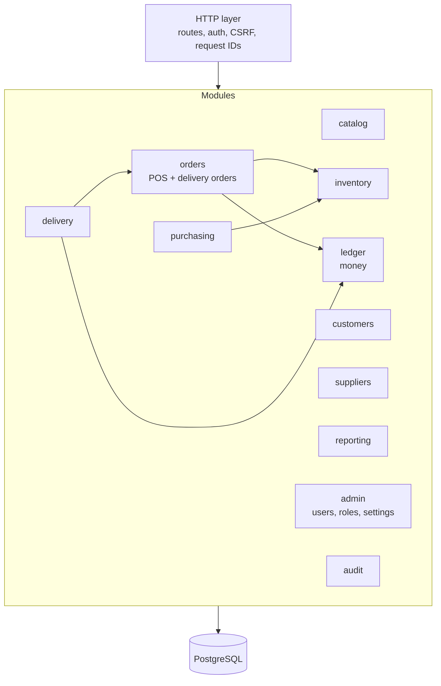
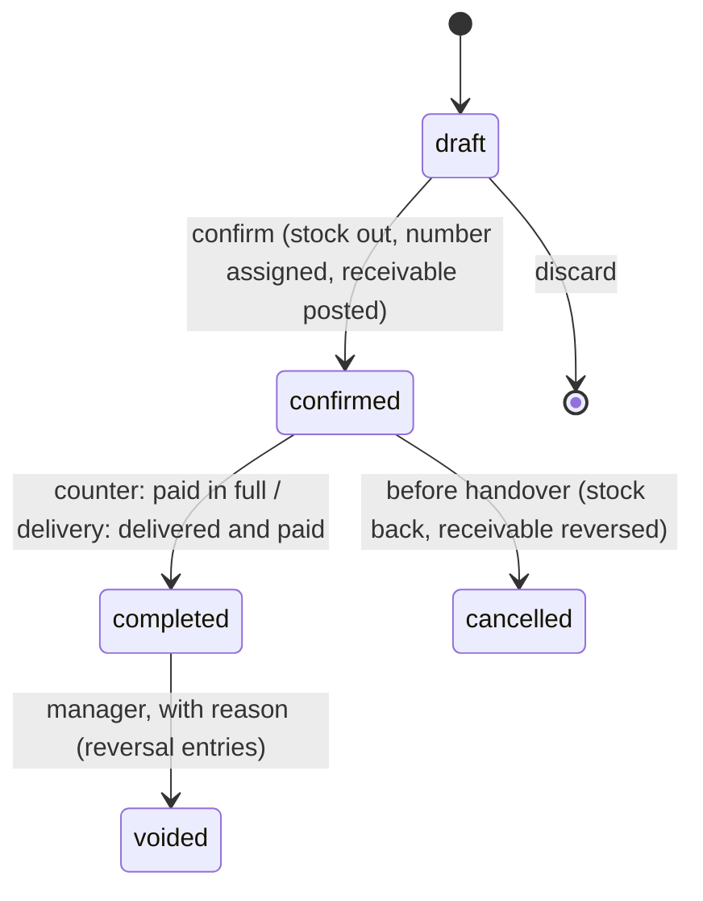
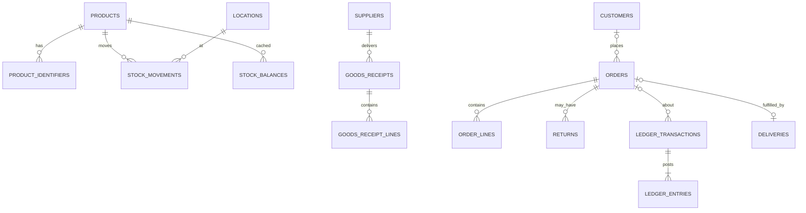

# Jehovah Jireh — System Architecture

| | |
|---|---|
| **Product** | Jehovah Jireh Retail Management System (JJ Retail) |
| **Status** | Accepted for implementation |
| **Version** | 2.0 |
| **Last updated** | 5 November 2026 |
| **Related** | [Delivery.md](Delivery.md) · [Operations.md](Operations.md) · [docs/adr/](docs/adr/README.md) · [v1 archive](docs/archive/Architecture-v1.md) |

---

## 1. Purpose

Jehovah Jireh is a retail management system for one shop. It covers the
product catalogue, registering products from printed labels, inventory,
purchasing, point of sale, customer orders and payments, delivery, and
reporting.

The first products are **Ektra by Superware** items. Their boxes carry a
printed text label (description, size, model code) and **no barcode**.
The shop will not print its own barcode labels. So products are
identified by their printed **product code**: typed, searched, or read
from a photo by OCR.

OCR is a way to fill in a form, not a source of truth. A person always
reviews what OCR read before anything is saved.

### 1.1 Goals

1. A reliable, searchable product catalogue.
2. Fast product lookup by printed code, without barcodes.
3. Register products by photographing their labels.
4. Accurate stock, with a history of every change.
5. A fast POS for counter sales.
6. Orders that can be paid later and delivered by a driver.
7. A clear record of where every rupee is: till, UPI, a driver's
   pocket, or still owed by a customer.
8. Simple enough for one person to run in production.

### 1.2 Non-goals (first release)

Full accounting, payroll, e-commerce storefront, multi-store,
multi-business tenancy, offline POS, payment gateway integration,
loyalty, demand forecasting, the delivery offer board (see
[Delivery.md §11](Delivery.md#11-later-phase-driver-pool-and-offer-board)).

### 1.3 Key decisions

| Decision | Choice | Record |
|---|---|---|
| Stack and shape | Rust/Axum modular monolith, Vue 3, PostgreSQL | [ADR-0001](docs/adr/0001-modular-monolith-stack.md) |
| Hosting | One cloud server; online-only; no offline mode | [ADR-0002](docs/adr/0002-cloud-hosting-online-only.md) |
| Product identification | Product-code search + OCR; no barcodes | [ADR-0003](docs/adr/0003-product-identification-without-barcodes.md) |
| Tax | Tax off by default; GST is an admin setting; gapless document numbers from day one | [ADR-0004](docs/adr/0004-optional-gst-and-document-numbering.md) |
| Orders | One `orders` model for counter and delivery; stock deducted at confirmation | [ADR-0005](docs/adr/0005-unified-order-model.md) |
| Money | Double-entry money ledger for payments, driver cash and payouts | [ADR-0006](docs/adr/0006-money-ledger.md) |
| Delivery | Manager assigns drivers first; offer board later | [ADR-0007](docs/adr/0007-manual-driver-assignment-first.md) |

### 1.4 Principles

- **Correct before convenient.** Stock and money change only inside
  database transactions, and every change leaves a record.
- **Two ledgers.** Stock changes are rows in `stock_movements`. Money
  changes are rows in `ledger_entries`. Balances are calculated from
  those rows (or cached and reconciled against them), never edited
  directly.
- **Snapshots.** Orders store the name, price, tax, fee and payment
  terms that applied at the time. Later catalogue or settings changes
  do not rewrite history.
- **The backend decides.** The browser handles screens and OCR. Prices,
  totals, permissions and stock rules are enforced by the API.
- **No LLM dependency.** Text extraction uses OCR, normalisation,
  rule-based parsing and database search.
- **Boring operations.** One server, systemd, Caddy, PostgreSQL. No
  Redis, queues, Kubernetes or microservices until a measured need.

## 2. Scope and assumptions

- One business, one store. Locations are modelled explicitly so a
  second store or warehouse can be added later.
- Used through a web app (installable PWA) on a shop desktop or
  tablet, staff phones, and drivers' phones.
- Hosted in the cloud. The shop's internet is reliable
  ([ADR-0002](docs/adr/0002-cloud-hosting-online-only.md)).
- Not GST-registered today. GST can be switched on later by an admin
  ([ADR-0004](docs/adr/0004-optional-gst-and-document-numbering.md)).
- Deliveries: about 1–3 a day at launch, expected to grow.
- Currency INR, timezone Asia/Kolkata, financial year April–March. All
  configurable.

## 3. System context



### 3.1 Roles

Permissions are attached to roles; one person can have several roles.
Code checks permissions, never role names.

| Role | Can do |
|---|---|
| Administrator | Users, roles, settings (including tax mode), everything below |
| Manager | Products, purchasing, stock adjustments, voids, refunds, delivery dispatch, driver settlement, reports |
| Cashier | Search products, create and confirm orders, take payments, print receipts, record remittances from drivers |
| Stock operator | Register products by scanning, receive goods, stock counts |
| Delivery driver | Only their own assigned deliveries and their own cash/settlement summary |
| Auditor | Read-only: transactions, movements, ledger, reports |

## 4. Technology

| Layer | Choice | Notes |
|---|---|---|
| Frontend | Vue 3 + TypeScript + Vite | Feature-folder structure (§12) |
| UI | Tailwind CSS | One component set; touch-friendly for tablet POS |
| State | Pinia for shared state only | Session, settings, active POS cart |
| PWA | Service worker | Caches app shell and OCR model; **no offline writes** |
| OCR | PaddleOCR (PP-OCR models) in a Web Worker | Run via the PaddleOCR.js package or ONNX Runtime Web. Fallback: Tesseract.js. Pick after measuring on shop devices (§7.5) |
| Image prep | Canvas API; OpenCV.js only if needed | Crop, rotate, contrast |
| Backend | Rust, Axum, Tokio | One binary |
| DB access | SQLx with compile-time checked queries | Migrations via `sqlx migrate` |
| Money/quantity types | `rust_decimal` ↔ `NUMERIC(12,2)`; quantities `BIGINT` base units | Never floats |
| Database | PostgreSQL 16 with `pg_trgm` | Source of truth |
| Auth | Server-side sessions in Postgres, HttpOnly cookie, Argon2id | §13 |
| Proxy | Caddy | Automatic TLS |
| Logs | `tracing` with JSON output | Request IDs |

## 5. Application architecture

One deployable Rust service, split into modules by business area. Each
module owns its tables and rules. Modules call each other through
service functions, not by querying each other's tables, except for
reporting, which reads across them.



### 5.1 Layers within a module

- `routes.rs`: parse the request, check the permission, call a service,
  map the result to HTTP. No SQL or business rules here.
- `service.rs`: use cases. Opens the transaction and owns it.
- `domain.rs`: pure types and rules (status transitions, totals,
  validation). No I/O. Most unit tests live here.
- `repo.rs`: SQLx queries. Each function takes a `&mut PgConnection` so
  it runs inside whatever transaction the service passes in.
- `dto.rs`: request and response types.

### 5.2 Transactions

Every use case that writes more than one row runs in one transaction.
If any step fails, everything rolls back, and the API never reports
partial success.

| Use case | In one transaction |
|---|---|
| Confirm order | order + lines snapshot, document number, stock movements, balance updates, ledger postings |
| Take payment | ledger transaction (+ entries) |
| Receive goods | goods receipt + lines, stock movements, balances |
| Return / void | return record, stock movements by disposition, ledger reversal |
| Driver remittance | ledger transaction; verification by shop user |

## 6. Product catalogue

The catalogue says what a product is. Stock is held separately (§8).

### 6.1 Product fields

Name, description, brand, category, **base code** and **variant code**
(§6.3), internal SKU (optional), base unit (`piece`, `set`, …), pack
quantity, structured attributes (JSONB: shape, size, diameter, height,
lid material, …), default cost, selling price, optional HSN code, tax
category, images, active/archived.

Products referenced by any transaction are archived, never deleted.

### 6.2 Identifiers

| Identifier | Meaning |
|---|---|
| `product_id` | System primary key (UUID). Never shown as a business code. |
| `product_code` | Printed by the manufacturer, e.g. `B 6275-4.75`. |
| `sku` | Optional internal code assigned by the shop. |
| `barcode` | Optional; reserved for future suppliers that use barcodes. |
| alias | Other names or codes staff use for the product. |

All of these except `product_id` live in `product_identifiers` with a
type, the original text, and a normalised value. Uniqueness is
`(brand_id, identifier_type, normalized_value)`, because a code is only
guaranteed unique within one manufacturer.

### 6.3 Code normalisation and variants

The code parser is a Rust module with a matching TypeScript port
(the frontend uses it to parse OCR). Both run the **same test cases**
from one shared fixtures file.

Normalisation:
1. Unicode NFKC; turn all dash characters into `-`; uppercase.
2. Remove spaces: `B 6275-4.75` → `B6275-4.75`.
3. Split into a **base code** `B6275` and a **variant** `4.75`.

All size variants share one base code. Search groups results by base
code, so the cashier sees every size of a model together.

### 6.4 Lookup (the heart of the POS)

`GET /api/v1/products/search?q=` answers in this order:

1. Exact normalised code match.
2. Base-code match (all variants).
3. Code prefix match on digits, so typing `627` already shows `B6275-*`.
   Uses a B-tree index with `text_pattern_ops`.
4. `pg_trgm` similarity on name, aliases and attributes.

Results come back ranked and labelled with how they matched. Target:
**under 100 ms server time** at 10,000 products.

**OCR-tolerant lookup** (used only for OCR input, never typed input):
expand common OCR confusions in the code (`O↔0`, `I/l↔1`, `S↔5`,
`B↔8`, `Z↔2`) into candidates. Show the matches as suggestions for a
person to confirm. Never auto-select one.

## 7. Label scanning (OCR)

The scanner has two modes. Both use one shared OCR worker.

| Mode | Where | Output |
|---|---|---|
| **Register** | Products → Scan label | Full parse into an editable new-product form, plus existing matches |
| **Find** | POS and goods receipt | Code only; jumps to search results |

### 7.1 Flow (register mode)

1. Capture from the camera, or upload an image.
2. Person crops to the label.
3. Preprocess: rotate, grayscale, contrast.
4. OCR returns lines of text with confidence scores and bounding boxes.
5. Rule-based parser proposes fields (§7.2).
6. Search for existing products by the proposed code (§6.4).
7. Person either picks an existing product or edits and confirms a new
   one. Only then does the API create anything.

Creating a product **never** adds stock. Adding stock is a goods
receipt or an opening-balance adjustment.

### 7.2 Parser

The parser proposes values in stages, and every proposal keeps a
reference to the OCR line it came from:

1. Normalise text, keeping the original as well.
2. Product code: configurable patterns per brand. For Ektra:
   `\bB\s?\d{4,}(?:-\d+(?:\.\d+)?)?\b`.
3. Dimensions and units (`4.75`, `inch`, `"`, `H1:3`).
4. Quantity and pack wording (`1 Pcs Set`).
5. Known attributes from a vocabulary table (shape, size, lid, material).
6. Leftover text becomes candidates for the name and description.

The parser never invents a value. A field it can't find stays empty.

### 7.3 Test corpus

Real label photos go in `fixtures/labels/` with the expected fields in a
JSON file next to each one. CI measures field accuracy (product code,
name, size) for each field, and reports a drop as a failure. Include
blurry, rotated, dim and partly covered labels.

### 7.4 Performance

- Load the model lazily on first use, show download progress, and keep
  it cached by the service worker.
- Run inference in a Web Worker and reuse it across scans.
- WebGPU is an optional speed-up, not a requirement.
- Don't upload label photos unless the person saves one as a product
  image.

### 7.5 Spike before Phase 3

Measure on the shop's actual phones and tablet: model size, time to
first result, time per scan, memory use, and accuracy on the corpus.
Compare the PaddleOCR.js package, PP-OCR via ONNX Runtime Web, and
Tesseract.js, then pick one. Record the choice as an ADR.

## 8. Inventory

### 8.1 Ledger

Every stock change is an immutable row in `stock_movements`:
product, location, signed quantity, unit cost (for movements that bring
stock in), movement type, source document (type + ID), actor,
timestamp, reason.

`stock_balances (product_id, location_id, on_hand)` is a cache kept in
step with the ledger, updated **in the same transaction** as each
movement. A nightly job compares it with `SUM(quantity)` from the
ledger and reports any mismatch. It never silently corrects one.

Movement types:

| Type | Sign | Source |
|---|---|---|
| `opening_balance` | + | stock count at go-live |
| `purchase_receipt` | + | goods receipt |
| `sale` | − | order confirmation |
| `order_cancel` | + | order cancelled before handover |
| `customer_return` | + | return marked sellable |
| `delivery_return` | + | failed delivery checked back in as sellable |
| `damage` | − | write-off |
| `supplier_return` | − | goods sent back |
| `adjustment_in` / `adjustment_out` | ± | stock count difference, with a reason |
| `transfer_in` / `transfer_out` | ± | future, multi-location |

Returned goods that are damaged or need inspection are **not** put back
as sellable stock. They get a `damage` movement or an
`inspection` hold (a separate location), chosen by the person.

### 8.2 Quantities

Quantities are whole `BIGINT` numbers in the product's base unit. A box
of 6 is entered as 6 base units only if the product defines pack
quantity 6. If loose goods sold by weight are ever stocked, this
decision gets revisited.

### 8.3 Concurrency

Negative stock is **not allowed** by default. Deduct with a
conditional update:

```sql
UPDATE stock_balances
   SET on_hand = on_hand - $qty
 WHERE product_id = $1 AND location_id = $2 AND on_hand >= $qty
RETURNING on_hand;
```

If no row comes back, stock is insufficient and the transaction rolls
back. When several lines are deducted together, lock them in a fixed
order (sorted by product_id) so two transactions can't deadlock.
Allowing negative stock is an admin setting; balances that go negative
are flagged for a stock count.

## 9. Purchasing

1. Purchase order (optional for a small shop).
2. Goods receipt: supplier, lines, quantity received, actual cost per
   unit. Partial receipts are allowed.
3. Confirming the receipt creates `purchase_receipt` movements.
4. Supplier invoice and payment status are tracked separately from the
   physical receipt.

A purchase order never adds stock; only a confirmed goods receipt does.
The **Find** scanner mode works on the receiving screen too.

**Costing method: weighted average.** Each receipt recalculates the
product's average cost. Every `sale` movement stores the average cost
at that moment, so gross margin can be reported. FIFO can be added later.

## 10. Orders and payments

### 10.1 One order model

Counter sales and delivery orders are the same `orders` entity
([ADR-0005](docs/adr/0005-unified-order-model.md)):

| Field | Values |
|---|---|
| `fulfilment` | `counter`, `delivery` |
| `status` | `draft` → `confirmed` → `completed`; or `cancelled`; `voided` (manager only) |
| `payment_status` | derived: `unpaid`, `partially_paid`, `paid`, `refunded`, `partially_refunded` |



- A **counter sale** normally goes draft → confirmed → paid →
  completed in one go. On screen it's one "Charge" button that makes a
  single API call.
- A **delivery order** is confirmed (stock set aside, number assigned)
  and may stay unpaid until the driver collects. Its delivery steps are
  tracked in [Delivery.md](Delivery.md).
- Drafts are held carts. They don't affect stock or money.

### 10.2 What happens at confirmation

All in one transaction:

1. Recalculate every line on the server: current price, permitted
   discount, tax under the current `tax_mode`.
2. Snapshot each line: product name, code, unit, unit price, discount,
   tax rate and amount, average cost.
3. For delivery orders, snapshot the delivery fee and the payment
   arrangement ([Delivery.md §6](Delivery.md#6-money)).
4. Assign the document number (§10.4).
5. Deduct stock (`sale` movements, §8.3).
6. Post the receivable to the money ledger (§10.3).

Stock is deducted at **confirmation**, not at handover. Once confirmed,
the goods are set aside for this order and can't be sold again at the
counter.

### 10.3 Money ledger

All money is recorded as **double-entry postings**
([ADR-0006](docs/adr/0006-money-ledger.md)). This is not a full
accounting system. Its job is to answer three questions exactly:
*who owes what, who is holding what, and what has been earned.*

Every money event is one `ledger_transactions` row with two or more
`ledger_entries` rows. The entry amounts in a transaction **sum to
zero**; a deferred constraint trigger enforces this. Debits are
positive, credits negative.

Accounts (`account` + optional `ref_id`):

| Account | ref | Meaning |
|---|---|---|
| `receivable` | order | What the customer still owes on this order |
| `cash_till` | location | Cash in the shop |
| `upi_bank` | — | UPI, card or bank money received by the shop |
| `sales_revenue` | — | Goods sold, after discounts |
| `tax_payable` | — | GST collected (only when GST is on) |
| `delivery_fee_income` | — | Delivery fees charged to customers |
| `driver_custody` | driver | Shop money a driver is currently holding |
| `driver_payable` | driver | What the shop owes a driver for deliveries |
| `delivery_expense` | — | Cost of driver pay |
| `sales_returns` | — | Refunds of goods sold |

Postings:

| Event | Entries |
|---|---|
| Confirm order ₹1,000 + ₹70 fee | Dr `receivable[o]` 1,070 · Cr `sales_revenue` 1,000 · Cr `delivery_fee_income` 70 |
| Customer pays cash at counter | Dr `cash_till` · Cr `receivable[o]` |
| Customer pays UPI to shop | Dr `upi_bank` · Cr `receivable[o]` |
| Driver collects cash at the door | Dr `driver_custody[d]` · Cr `receivable[o]` |
| Driver hands cash to shop | Dr `cash_till` · Cr `driver_custody[d]` |
| Refund cash | Dr `sales_returns` · Cr `cash_till` |

Driver earnings, keeping the fee, and payouts are covered in
[Delivery.md §6](Delivery.md#6-money).

Rules:
- Ledger rows are never updated or deleted. A correction is a new
  transaction that reverses the old one (`reverses_id`), with a reason
  and the actor.
- A transaction records the method (cash/UPI/card/bank), who
  physically received the money, an optional external reference (e.g. a
  UPI reference number), and an **idempotency key** (unique).
- `payment_status` and every balance shown on screen are calculated
  from entries, never stored as editable fields.
- Recording a UPI payment means "staff say it arrived". A UPI payment
  recorded by a driver is marked **unverified** until a cashier or
  manager confirms it against the shop's UPI statement.

### 10.4 Document numbers

Receipt and invoice numbers have no gaps and run in sequence per
document type and financial year, e.g. `JJ/2026-27/000123`. They come
from `document_sequences (doc_type, fiscal_year, next_value)` via
`UPDATE … RETURNING` inside the confirming transaction. PostgreSQL
sequences aren't used here because they can skip numbers. The row lock
on `document_sequences` puts confirmations in a queue, which is fine at
one shop's volume.

### 10.5 Discounts, voids, returns

- A discount is an amount or percentage per line, capped by a
  permission-based limit, and requires a reason.
- A void (completed → voided) needs `orders.void` and a reason. It
  reverses stock and money with new records. Nothing is deleted.
- A return refers back to the original order and its lines. The person
  chooses a disposition for each line (sellable / damaged / inspection).
  A refund is posted to the ledger.

### 10.6 Customer credit

Not in v1 for counter sales: a counter sale has to be paid in full to
complete. Delivery orders may be unpaid until delivery. The ledger
already supports an outstanding receivable, so allowing credit later is
mainly a permission and UI change.

### 10.7 Receipts

The server returns receipt data. The frontend renders it with an 80mm /
58mm print stylesheet and calls `window.print()`. That works with any
thermal printer that has an OS driver. Direct ESC/POS printing is
deferred until the printer model is known.

## 11. Pricing and tax

- Keep cost and selling price separate.
- Each sale line snapshots unit price, discount, tax rate and tax
  amount.
- `settings.tax_mode`:
  - `none` (default): no tax is calculated or printed. Tax columns are
    stored as 0. Documents are titled **Receipt** / **Bill of Supply**
    per configuration.
  - `gst`: tax rate comes from each product's tax category. Choose
    whether prices include or exclude tax. Split CGST/SGST or IGST by
    place of supply. Invoices show GSTIN and HSN. Documents are titled
    **Tax Invoice**.
- Switching tax mode applies to new orders only.
- The GST rules must be checked with an accountant before switching
  `gst` on. This document doesn't set any tax rate.

## 12. Frontend

### 12.1 Areas

Overview · POS · Orders · Products (incl. Scan label) · Inventory ·
Purchasing · Suppliers · Customers · Deliveries · Reports · Admin.

Drivers get a separate, minimal mobile area (`/driver`), described in
[Delivery.md §9](Delivery.md#9-screens).

The menu only shows what a user's permissions allow. Hiding a menu item
isn't security: the API checks every permission itself.

### 12.2 Structure

```text
frontend/src/
├── app/            router, layouts, guards
├── modules/
│   ├── pos/        cart, search box, charge dialog
│   ├── orders/
│   ├── products/
│   ├── scanner/    camera, crop, worker/, parser/
│   ├── inventory/
│   ├── purchasing/
│   ├── deliveries/
│   ├── driver/
│   ├── reports/
│   └── admin/
└── shared/         api client, components, composables, money/format utils
```

### 12.3 State and API

- Server data is owned by the server. Reload after changes rather than
  keeping a second copy of balances in the browser.
- The POS cart lives in Pinia and is saved to `localStorage`, so a page
  reload or a brief network drop doesn't lose it. Only the cart is
  saved locally; no secrets.
- Every money-moving request (confirm, pay, remit) sends an
  `Idempotency-Key` header. The key is generated once per user action
  and reused on retry.
- POS search: debounce at 120 ms and cancel stale requests with
  `AbortController`.

### 12.4 POS speed targets

- Search results within 300 ms of a keystroke, end to end.
- Common sale (2–3 items, cash): about 15 seconds.
- Keyboard-first: `/` focuses search, `Enter` adds the top result, `+`
  and `−` change quantity, `F2` charges.
- Recent and best-selling items are available with one tap.

## 13. Security

- **Passwords:** Argon2id, with rate-limited login (per IP and per
  account).
- **Sessions:** a random token in a `Secure; HttpOnly; SameSite=Lax`
  cookie; only its hash is stored in `sessions`. Idle timeout 12 h for
  staff and 30 days for drivers (re-login to revoke). Logout and an
  admin "revoke all" both delete the session rows.
- **CSRF:** every state-changing request must carry an `X-CSRF-Token`
  header that matches the session's token. Frontend and API share one
  origin, so CORS stays closed.
- **Authorization:** checked in every handler with
  `require(perm)`. Queries scoped to one driver take the user ID from
  the session, never from the request.
- **Input:** request size limits, validated DTOs, and parameterised SQL
  only.
- **Files:** check the real file type, limit size, give files
  server-generated names, strip EXIF, and store them outside the web
  root.
- **Audit:** privileged actions (adjustments, voids, refunds, price
  changes, overrides, settings, user and role changes) write
  `audit_logs` rows with actor, action, entity, before/after values and
  request ID.
- **Logs:** never include passwords, tokens, or full customer phone
  numbers or addresses.

## 14. Data model

PostgreSQL is the source of truth. Use foreign keys, unique and check
constraints, and `ON DELETE RESTRICT` for anything financial. Never use
cascading deletes on transactions. Primary keys are UUIDv7. Timestamps
are `timestamptz` in UTC. Money is `NUMERIC(12,2)`.

| Area | Tables |
|---|---|
| Admin | `users`, `roles`, `permissions`, `role_permissions`, `user_roles`, `sessions`, `settings`, `audit_logs`, `document_sequences` |
| Catalogue | `brands`, `categories`, `products`, `product_identifiers`, `product_images`, `attribute_vocabulary` |
| Inventory | `locations`, `stock_balances`, `stock_movements`, `stock_counts`, `stock_count_lines` |
| Purchasing | `suppliers`, `purchase_orders`, `purchase_order_lines`, `goods_receipts`, `goods_receipt_lines` |
| Orders | `customers`, `orders`, `order_lines`, `returns`, `return_lines` |
| Money | `ledger_transactions`, `ledger_entries` |
| Delivery | see [Delivery.md §8](Delivery.md#8-data-model) |



Key sketch (illustrative, not the final migration):

```sql
CREATE TABLE product_identifiers (
    id               UUID PRIMARY KEY,
    product_id       UUID NOT NULL REFERENCES products(id),
    brand_id         UUID NOT NULL REFERENCES brands(id),
    identifier_type  TEXT NOT NULL CHECK (identifier_type IN ('product_code','sku','barcode','alias')),
    raw_value        TEXT NOT NULL,
    normalized_value TEXT NOT NULL,
    base_code        TEXT,
    UNIQUE (brand_id, identifier_type, normalized_value)
);
CREATE INDEX ON product_identifiers (normalized_value text_pattern_ops);
CREATE INDEX ON product_identifiers USING gin (normalized_value gin_trgm_ops);

CREATE TABLE ledger_transactions (
    id              UUID PRIMARY KEY,
    kind            TEXT NOT NULL,          -- order_confirm, payment, remittance, payout, refund, reversal, …
    order_id        UUID REFERENCES orders(id),
    delivery_id     UUID,
    method          TEXT,                   -- cash, upi, card, bank, internal
    received_by     UUID REFERENCES users(id),
    external_ref    TEXT,
    verified_at     TIMESTAMPTZ,
    verified_by     UUID REFERENCES users(id),
    reverses_id     UUID REFERENCES ledger_transactions(id),
    reason          TEXT,
    actor_id        UUID NOT NULL REFERENCES users(id),
    idempotency_key TEXT NOT NULL UNIQUE,
    occurred_at     TIMESTAMPTZ NOT NULL DEFAULT now()
);

CREATE TABLE ledger_entries (
    id             UUID PRIMARY KEY,
    transaction_id UUID NOT NULL REFERENCES ledger_transactions(id),
    account        TEXT NOT NULL,
    ref_id         UUID,
    amount         NUMERIC(12,2) NOT NULL CHECK (amount <> 0)  -- debit +, credit −
);
-- Deferred constraint trigger: SUM(amount) per transaction_id = 0.
```

## 15. API

JSON over `/api/v1`. Errors always use one shape:

```json
{ "error": { "code": "INSUFFICIENT_STOCK", "message": "Only 2 left of B6275-4.75.", "details": {}, "request_id": "…" } }
```

Status codes: 400 malformed · 401 not logged in · 403 not permitted ·
404 not found · 409 conflict (duplicate code, wrong state, idempotency
key reused with a different body) · 422 fails a business rule · 500
unexpected. Responses never include SQL errors or stack traces.

**Idempotency:** a repeat of an idempotent request with the same key and
the same body returns the original result. The same key with a
different body returns 409.

| Area | Endpoints |
|---|---|
| Auth | `POST /auth/login`, `POST /auth/logout`, `GET /auth/me` |
| Products | `GET/POST /products`, `GET/PATCH /products/{id}`, `POST /products/{id}/archive`, `GET /products/search?q=&mode=typed\|ocr` |
| Identifiers | `POST /products/{id}/identifiers`, `DELETE /products/{id}/identifiers/{iid}` |
| Inventory | `GET /inventory/balances`, `GET /inventory/movements`, `POST /inventory/adjustments`, `POST /inventory/counts` |
| Purchasing | `GET/POST /suppliers`, `GET/POST /purchase-orders`, `POST /goods-receipts`, `POST /goods-receipts/{id}/confirm` |
| Orders | `POST /orders` (draft), `PATCH /orders/{id}`, `POST /orders/{id}/confirm`, `POST /orders/{id}/cancel`, `POST /orders/{id}/void`, `GET /orders/{id}`, `GET /orders/{id}/receipt` |
| Counter sale | `POST /orders/checkout` — draft + confirm + payment in one call |
| Payments | `POST /orders/{id}/payments`, `POST /ledger/transactions/{id}/verify`, `POST /ledger/transactions/{id}/reverse` |
| Returns | `POST /returns` |
| Reports | `GET /reports/daily`, `/reports/sales`, `/reports/stock`, `/reports/movements`, `/reports/cash` |
| Admin | `GET/POST/PATCH /users`, `GET/PATCH /settings` |
| Delivery | see [Delivery.md §7](Delivery.md#7-api) |

## 16. Backend structure

```text
backend/
├── Cargo.toml                 # crate: jj-retail-api
├── migrations/
├── src/
│   ├── main.rs  config.rs  state.rs  error.rs
│   ├── http/                  # router, middleware (session, csrf, request id), extractors
│   ├── shared/                # money, ids, time, pagination, idempotency, code normalisation
│   ├── admin/  audit/
│   ├── catalog/  inventory/  purchasing/
│   ├── orders/  ledger/  delivery/
│   ├── customers/  suppliers/  reporting/
│   └── jobs/                  # nightly reconciliation (tokio interval task)
└── tests/                     # API + integration tests against a real Postgres
```

Shared state: `PgPool`, config, clock. No generic repository traits
until there's a real need for them.

## 17. Reports

Daily summary · sales by product/category · gross, discounts, tax, net ·
gross margin (weighted-average cost) · purchases · stock on hand and
valuation · low stock · movement history · returns and voids · **cash
position** (till, UPI, each driver's custody, driver payables,
outstanding receivables) · delivery summary.

Every report states its date range, timezone and how it's calculated.
Revenue is never labelled as profit.

## 18. Business rules (each one gets a test)

1. OCR never creates a product or a stock movement without a person
   confirming.
2. Creating a product doesn't add stock.
3. Only a confirmed goods receipt adds purchased stock.
4. Confirming an order deducts stock exactly once. A retried request
   doesn't deduct it again.
5. Stock can't go negative unless the admin setting allows it.
6. Two cashiers can't both sell the last unit.
7. Each confirmed order gets exactly one document number, and numbers
   have no gaps.
8. Order lines keep their price, tax and name even when the catalogue
   changes.
9. The server calculates totals; totals sent by the client are ignored.
10. Every ledger transaction sums to zero.
11. Ledger rows and stock movements are never updated or deleted.
12. A returned item doesn't become sellable unless its disposition is
    `sellable`.
13. Adjustments, voids, refunds and discount overrides need a
    permission and a reason.
14. Stock balances match the movement ledger, and every account balance
    matches its ledger entries.
15. A driver can only see and act on their own deliveries.

## 19. Testing

- **Unit:** code normalisation, parser (against the shared fixtures),
  totals and tax for both tax modes, discount limits, order and delivery
  state transitions, ledger posting builders (each sums to zero).
- **OCR corpus:** field accuracy on `fixtures/labels/`, tracked in CI.
- **Integration (real Postgres, one schema per test):** identifier
  uniqueness, goods receipt → balance, checkout → stock and ledger,
  **concurrent checkout of the last unit**, idempotent retry,
  gapless numbering under concurrent confirmations, rollback when a
  step fails, void/return reversals, reconciliation job.
- **End-to-end (Playwright):** register a product by scanning
  (fixture image fed to the camera) → receive stock → counter sale →
  receipt → return. Delivery flow in
  [Delivery.md §10](Delivery.md#10-acceptance-criteria-v1).

## 20. Roadmap

Each phase is a working vertical slice with exit criteria.

| Phase | Scope | Exit criteria |
|---|---|---|
| **1. Foundation** | Repo, Axum + SQLx + migrations, Vue + PWA shell, sessions, permissions, error format, logging, health checks, CI, deploy to the cloud server | Log in on a phone over HTTPS, reach a protected page, deploys run from CI |
| **2. Catalogue + lookup** | Brands, categories, products, identifiers, code normalisation, search (§6.4), product screens, CSV import | Search by partial code finds the right variant group in under 100 ms server time |
| **3. Scanner** | OCR spike (§7.5), worker, crop, parser + corpus, register and find modes | Register real Ektra products by scanning; corpus accuracy measured and recorded |
| **4. Inventory + purchasing** | Locations, movements, balances, opening stock count, adjustments, suppliers, goods receipts, weighted-average cost, reconciliation job | Every unit on hand can be traced to a receipt or opening count |
| **5. Orders + POS + ledger** | Orders, checkout, ledger, document numbers, receipts, discounts, voids, returns, cash report, tax_mode setting | Concurrency and idempotency tests pass; a day's sales reconcile to the till |
| **6. Delivery v1** | [Delivery.md](Delivery.md) phase 1 | [Delivery.md §10](Delivery.md#10-acceptance-criteria-v1) |
| **7. Go-live readiness** | Reports, audit views, backups + **restore drill**, uptime alerting, staff guide, test on shop devices | [Operations.md](Operations.md) checklist complete |
| **Later** | Offer board, customer credit, GST go-live, ESC/POS printing, multi-location, payment gateway, accounting export | — |

## 21. Open questions

| Question | Needed by |
|---|---|
| Photos of 5–10 real Ektra labels (more later for the corpus) | Phase 3 |
| Which devices: shop desktop/tablet model, staff and driver phones | Phase 3 spike |
| Receipt printer: model, 58 or 80 mm, USB or Bluetooth | Phase 5 |
| Number of cashiers; is shift/till open-close needed? | Phase 5 |
| Delivery zones and fees; default driver pay per delivery | Phase 6 |
| Roughly how many products (SKUs) at launch? | Phase 2 |

## Appendix A — Naming

| Thing | Name |
|---|---|
| Display name | Jehovah Jireh |
| Short name | JJ Retail |
| Backend crate | `jj-retail-api` |
| Frontend package | `jj-retail-web` |
| Database | `jj_retail` |
| API prefix | `/api/v1` |
| Document number prefix | `JJ` |

Internal identifiers use `jj` so the spelling of "Jehovah Jireh" never
leaks into code, URLs or the database name.

## Appendix B — Glossary

| Term | Meaning |
|---|---|
| Base code | Product code without the size variant, e.g. `B6275` |
| Stock movement | An immutable record of quantity entering or leaving a location |
| Stock balance | Cached current quantity, kept in step with the movement ledger |
| Ledger transaction | One money event, made of entries that sum to zero |
| Custody | Shop money a driver is physically holding |
| Receivable | Money a customer still owes on an order |
| Idempotency key | Client-generated key that makes retrying a request safe |
| Modular monolith | One deployable app split into internal modules by business area |
