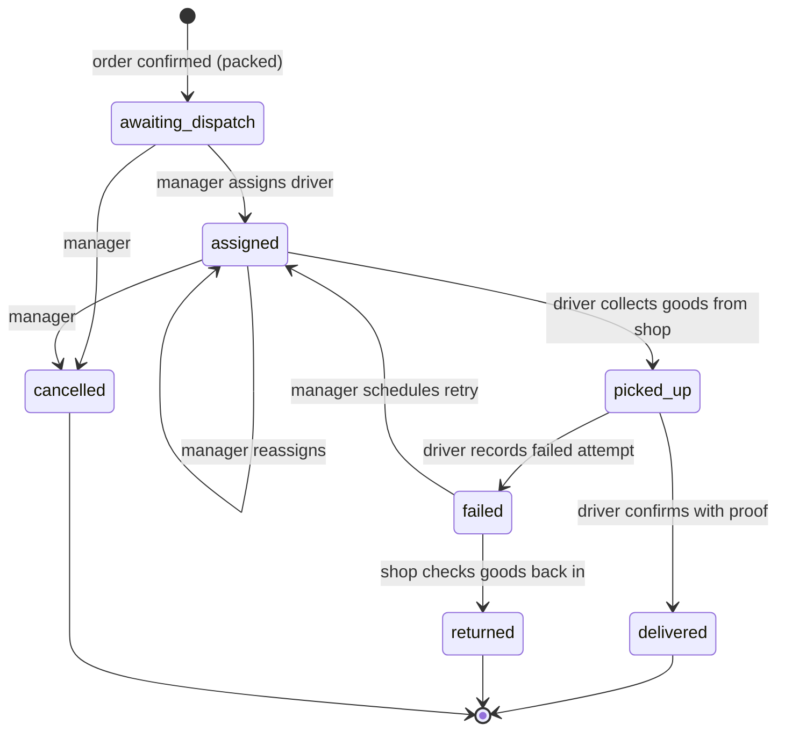

# Jehovah Jireh — Delivery

| | |
|---|---|
| **Status** | Accepted for implementation (phase 1); phase 2 is a design outline |
| **Version** | 2.0 |
| **Last updated** | 5 November 2026 |
| **Depends on** | [Architecture.md](Architecture.md) §10 (orders and money ledger) |
| **Replaces** | §21–28 of the [v1 architecture](docs/archive/Architecture-v1.md) |

---

## 1. Scope and phasing

Delivery volume at launch is about 1–3 orders a day, expected to grow.
So delivery is built in two phases
([ADR-0007](docs/adr/0007-manual-driver-assignment-first.md)):

| Phase | What | When |
|---|---|---|
| **1 — Manual dispatch** | A manager assigns each delivery to a known driver. Drivers use a small mobile area of the same app. Delivery fees by zone. Driver cash tracked in the money ledger. | Roadmap phase 6 |
| **2 — Driver pool** | Self-registration, driver onboarding and document checks, availability, an offer board where drivers accept jobs, notifications. | Once volume or driver count makes manual dispatch a bottleneck |

The phase 1 tables are shaped so phase 2 adds tables without changing
any existing ones.

Legal, insurance and driver-engagement questions are in
[Operations.md §4](Operations.md#4-delivery-drivers-legal-and-compliance).
They must be answered before the first driver starts. They don't change
the software design.

## 2. Core concepts

- A **delivery** belongs to exactly one order with
  `fulfilment = delivery`. The order owns the goods and the money; the
  delivery tracks moving the goods.
- Stock leaves the shelf when the **order is confirmed**
  ([Architecture §10.2](Architecture.md#102-what-happens-at-confirmation)).
  The delivery doesn't move stock until goods come back after a failed
  delivery.
- **Money is tracked separately from delivery status.** Marking an order
  `delivered` never marks it paid. Payment is a separate ledger event.
- The delivery stores its own copy of the recipient name, phone,
  address, fee and payment arrangement. Later edits to the customer
  record don't change it.

## 3. Lifecycle



| Transition | Who | Permission | Side effects |
|---|---|---|---|
| → `awaiting_dispatch` | system | — | created when a delivery order is confirmed |
| → `assigned` | manager | `deliveries.assign` | new `delivery_assignments` row; driver pay set (§6.2) |
| `assigned` → `assigned` | manager | `deliveries.assign` | previous assignment ended; previous driver loses access |
| → `picked_up` | assigned driver, or manager | `deliveries.update_own` | payment arrangement **frozen** |
| → `delivered` | assigned driver | `deliveries.update_own` | requires proof (§5); driver pay accrued (§6.3) |
| → `failed` | assigned driver | `deliveries.update_own` | requires a reason; goods still with driver |
| `failed` → `assigned` | manager | `deliveries.assign` | retry; may be the same driver |
| `failed` → `returned` | cashier/manager | `deliveries.check_in` | disposition for each line → stock movements; order cancelled or kept for retry later |
| → `cancelled` | manager | `deliveries.cancel` | order cancelled: `order_cancel` movements, receivable reversed, refund if prepaid |

The backend validates every transition: correct current status, the
actor is the assigned driver (for driver actions), and any required
data (proof, reason) is present. Every change writes a
`delivery_events` row (from, to, actor, time, note).

**Order completion:** an order with `fulfilment = delivery` becomes
`completed` automatically once the delivery is `delivered` **and** the
receivable is zero.

## 4. Driver access

Drivers have the `delivery_driver` role:

| Permission | Allows |
|---|---|
| `deliveries.read_own` | List and view deliveries **currently** assigned to them, plus their own delivery history |
| `deliveries.update_own` | Picked up / delivered / failed on their own active delivery |
| `deliveries.collect_own` | Record a customer payment they collected on their own delivery |
| `settlements.read_own` | Their own custody, earnings and payout summary |

Drivers **cannot**: browse orders, customers or products; change
prices, lines, fees or arrangements; see costs or reports; reassign
deliveries; or record that the shop received their cash (§6.5).

Every driver query filters by `assigned_driver_id = session.user_id`
on the server. Full recipient details (phone, address, instructions)
are only returned while the delivery is assigned to that driver and
still active. Once it's delivered, the driver's history shows only the
reference, locality, date, amounts and status.

## 5. Proof and failed attempts

`settings.delivery_proof`:
- `recipient_name` (default): the driver types who received the goods.
- `otp`: a 4-digit code generated at confirmation. It's printed on the
  customer's copy of the order, or sent by the cashier with a WhatsApp
  link (§9.3). The driver enters it to confirm delivery.

No photos in v1.

Failed-attempt reasons: `customer_unavailable`, `address_not_found`,
`customer_refused`, `unreachable_by_phone`, `other` (note required).
Each attempt is a `delivery_attempts` row.

A failed attempt doesn't refund anything or restore stock by itself.
The goods have to be checked back in (`returned`) and a disposition
chosen for each line, or the delivery has to be retried.

## 6. Money

All money uses the ledger in
[Architecture §10.3](Architecture.md#103-money-ledger)
([ADR-0006](docs/adr/0006-money-ledger.md)). This section adds the
delivery-specific rules.

### 6.1 Two separate amounts

- **Delivery fee:** what the customer is charged. Goes to
  `delivery_fee_income`. Can be 0 (waived).
- **Driver pay:** what the shop owes the driver for the job. Goes to
  `delivery_expense` / `driver_payable`.

They're separate numbers, and they don't have to be equal. Driver pay
is always recorded as money the shop owes, even when the driver keeps
it out of the cash they collected. That one rule covers every
arrangement in the v1 document without special cases.

### 6.2 Payment arrangement

Snapshotted on the delivery. Prefilled from settings, editable by a
manager until `picked_up`, then frozen. Each edit is audited.

| Field | Values | Meaning |
|---|---|---|
| `collector` | `shop`, `driver` | Who takes the customer's payment |
| `fee_charged` | amount ≥ 0 | Delivery fee on the order (0 = waived) |
| `driver_pay` | amount ≥ 0 | What the driver earns for this job; set by assignment at the latest |
| `driver_pay_method` | `retain_from_collection`, `paid_by_shop` | How the driver gets paid |

Validation:
- `retain_from_collection` requires `collector = driver`.
- With `retain_from_collection`, the driver keeps `driver_pay` only out
  of what they actually collected. If they collected less (partial
  payment), the shortfall stays in `driver_payable` and is paid later.
- The fee is added to the order total at confirmation. Changing it
  after confirmation is a manager action that posts an adjustment
  transaction. The original posting is never edited.

### 6.3 Postings per event

| Event | Ledger transaction |
|---|---|
| Order confirmed | Dr `receivable[o]` goods + fee · Cr `sales_revenue` goods · Cr `delivery_fee_income` fee |
| Customer pays shop before dispatch | Dr `cash_till` or `upi_bank` · Cr `receivable[o]` |
| Driver collects cash at the door | Dr `driver_custody[d]` · Cr `receivable[o]` |
| Customer pays UPI to the **shop's** QR at the door | Dr `upi_bank` · Cr `receivable[o]`, marked unverified until checked against the UPI statement |
| Delivery marked delivered | Dr `delivery_expense` driver_pay · Cr `driver_payable[d]` driver_pay |
| Driver keeps their pay (`retain_from_collection`) | Dr `driver_payable[d]` · Cr `driver_custody[d]`, posted automatically at delivered, capped at the cash they collected |
| Driver hands cash to shop | Dr `cash_till` · Cr `driver_custody[d]` (recorded by a cashier, §6.5) |
| Shop pays driver | Dr `driver_payable[d]` · Cr `cash_till` or `upi_bank` |
| Cash shortage written off | Dr `cash_shortage` · Cr `driver_custody[d]` (manager, reason required) |

Customers pay UPI to the shop's QR code only. Payments to a driver's
personal UPI aren't supported in v1, because the shop couldn't verify
them.

### 6.4 Worked examples

Goods ₹1,000. Balances shown after each delivery is fully settled.

**A — Driver collects, keeps the fee as pay** (fee ₹70, pay ₹70, retain)

| Step | receivable | custody[d] | payable[d] | cash_till |
|---|---|---|---|---|
| Confirm | 1,070 | | | |
| Driver collects ₹1,070 cash | 0 | 1,070 | | |
| Delivered: pay accrued ₹70 | | 1,070 | 70 | |
| Driver keeps ₹70 | | 1,000 | 0 | |
| Driver hands over ₹1,000 | | **0** | **0** | +1,000 |

**B — Driver collects, hands over everything, shop pays ₹50**
(fee ₹70, pay ₹50, paid_by_shop)

| Step | receivable | custody[d] | payable[d] | cash_till |
|---|---|---|---|---|
| Confirm | 1,070 | | | |
| Driver collects ₹1,070 | 0 | 1,070 | | |
| Delivered: pay accrued ₹50 | | 1,070 | 50 | |
| Driver hands over ₹1,070 | | 0 | 50 | +1,070 |
| Shop pays driver ₹50 | | **0** | **0** | −50 |

**C — Shop collects before dispatch, shop pays driver ₹50**
(collector shop, fee ₹70, pay ₹50)

Confirm → customer pays shop ₹1,070 (`cash_till` +1,070, receivable 0)
→ delivered (payable 50) → shop pays ₹50. The driver never holds
money.

**D — Fee waived, shop pays driver ₹50**
(fee ₹0, pay ₹50)

Receivable is ₹1,000. Everything else is as in B or C depending on the
collector. `delivery_fee_income` stays 0 and `delivery_expense` is ₹50,
so the free delivery shows up as a ₹50 cost instead of disappearing.

### 6.5 Handover and settlement

- The **driver** records collections on their own deliveries (the
  amount defaults to what's due; a lower amount needs a note and leaves
  the order partly paid).
- A **cashier or manager** records the cash handover with the driver
  present. Recording it counts as the shop confirming receipt. A driver
  can't record their own handover.
- A manager records payouts to the driver.
- Driver collections, handovers and payouts are **never silently netted
  against each other**. Keeping pay out of collections (example A) is
  its own visible posting.

**Driver settlement screen** (manager view per driver, and the driver's
own read-only version):

```
Driver: Lalremruata              Period: today
─────────────────────────────────────────────
Collected from customers     ₹2,140   (2 deliveries)
Kept as delivery pay           −₹70
Handed to shop             −₹1,000
Still holding (custody)      ₹1,070   ← owed to shop
─────────────────────────────────────────────
Earned (driver pay)            ₹120
Kept from collections          −₹70
Paid by shop                    ₹0
Still owed to driver            ₹50   ← owed by shop
```

Both totals come straight from `driver_custody[d]` and
`driver_payable[d]`, with the itemised list underneath.

### 6.6 Failed, returned and cancelled deliveries

| Situation | Stock | Money |
|---|---|---|
| Cancelled before pickup | `order_cancel` movements | Receivable reversed. Any prepayment refunded or kept as credit (manager chooses) |
| Failed, retried | No change (goods still out) | No change |
| Failed, goods returned | Disposition per line: `delivery_return` (sellable) / `damage` / inspection hold | Order cancelled: receivable reversed; prepayment refunded |
| Driver pay for a failed attempt | — | `settings.failed_attempt_pay` (default ₹0); a manager can add pay per attempt with a reason |

## 7. API

| Purpose | Endpoint | Permission |
|---|---|---|
| Dispatch queue | `GET /deliveries?status=` | `deliveries.read` |
| Delivery detail (staff) | `GET /deliveries/{id}` | `deliveries.read` |
| Assign / reassign | `POST /deliveries/{id}/assign` | `deliveries.assign` |
| Edit arrangement (before pickup) | `PATCH /deliveries/{id}/arrangement` | `deliveries.assign` |
| Cancel | `POST /deliveries/{id}/cancel` | `deliveries.cancel` |
| Check in returned goods | `POST /deliveries/{id}/check-in` | `deliveries.check_in` |
| Fee quote | `POST /delivery-fees/quote` | `orders.create` |
| Zones | `GET/POST /delivery-zones`, `PATCH /delivery-zones/{id}` | `settings.manage` |
| My active deliveries | `GET /me/deliveries` | `deliveries.read_own` |
| My delivery detail | `GET /me/deliveries/{id}` | `deliveries.read_own` |
| Status update | `POST /me/deliveries/{id}/status` | `deliveries.update_own` |
| Record collection | `POST /me/deliveries/{id}/collections` | `deliveries.collect_own` |
| My settlement summary | `GET /me/settlement` | `settlements.read_own` |
| Driver settlement (staff) | `GET /drivers/{id}/settlement` | `settlements.read` |
| Record handover | `POST /drivers/{id}/handovers` | `settlements.receive` |
| Pay driver | `POST /drivers/{id}/payouts` | `settlements.pay` |
| Drivers | `GET/POST /drivers`, `PATCH /drivers/{id}` | `drivers.manage` |

`/me/*` endpoints take the driver from the session, never from the
request. Every money endpoint requires an `Idempotency-Key`.

## 8. Data model

| Table | Purpose |
|---|---|
| `driver_profiles` | `user_id`, display name, phone, vehicle registration number, default pay, active flag, notes. Phase 1 keeps only the basic compliance fields listed in [Operations.md §4](Operations.md#4-delivery-drivers-legal-and-compliance) |
| `delivery_zones` | Name, localities covered (text list), fee, active, effective from |
| `deliveries` | `order_id` (unique), status, zone_id, address snapshot (recipient name, phone, address line, locality, landmark, instructions), proof type, OTP hash, timestamps per status |
| `delivery_arrangements` | Versioned arrangement (§6.2); `version`, `frozen_at`; a new row for each edit |
| `delivery_assignments` | driver_id, assigned_by, assigned_at, ended_at, end_reason |
| `delivery_events` | Immutable status history |
| `delivery_attempts` | Outcome, reason, note, time, driver |

Driver money lives entirely in `ledger_transactions` /
`ledger_entries` with `delivery_id` set. There are **no** separate
remittance, compensation or settlement tables. Settlement views are
queries over the ledger.

## 9. Screens

### 9.1 Order entry (cashier)

Choose "Delivery" → recipient and address (prefilled from the customer,
editable) → zone (sets the fee; manager can override with a reason) →
collector → confirm. The confirmation screen shows: goods, fee, total,
amount to be collected and by whom.

### 9.2 Dispatch (manager)

Awaiting-dispatch queue · assign driver (pay prefilled from the
driver's default) · active deliveries by driver · failed deliveries
needing a decision · settlement per driver · zones.

### 9.3 Driver (mobile, `/driver`)

- **My deliveries:** active jobs, each showing locality, amount to
  collect and status.
- **Detail:** recipient, `tel:` link, address with a map link (Google
  Maps search URL), instructions, item summary, amount to collect, what
  they keep or hand over.
- **Actions:** Picked up → Delivered (name or OTP) / Failed (reason).
  Record collection.
- **My money:** the settlement summary (§6.5).

### 9.4 Messaging in v1

There's no SMS, push or WhatsApp API integration. The dispatch screen
gives **WhatsApp links** (`https://wa.me/<phone>?text=<message>`) and
`tel:` links: to tell a driver about a job, and to send the customer
an OTP or an "out for delivery" message. At 1–3 deliveries a day this
is enough. Push notifications come with phase 2.

## 10. Acceptance criteria (v1)

1. A cashier creates a delivery order. The fee comes from the zone, and
   the total and amount to collect are shown before confirming.
2. Confirming deducts stock once and posts the receivable.
3. A manager assigns a driver. The driver sees only their own active
   deliveries, with full details only while the job is assigned to them.
4. Reassigning revokes the previous driver's access immediately.
5. Status transitions out of order are rejected with 409.
6. Delivered needs proof. Failed needs a reason.
7. Examples A–D (§6.4) produce exactly the balances shown, and every
   ledger transaction sums to zero.
8. Partial collection leaves the order partly paid and visible as
   outstanding.
9. Only shop staff can record a handover. Retried requests don't create
   duplicates.
10. A failed delivery returned to the shop restores sellable stock only
    for lines marked sellable.
11. The cash position report shows till, UPI, each driver's custody,
    driver payables and receivables, and they add up.

## 11. Later phase: driver pool and offer board

Design outline only; it gets its own ADR before it's built. Rules
carried over from v1 §28:

- **Onboarding states:** `applied` → `under_review` → `approved` /
  `rejected`; `suspended`, `deactivated`. Only `approved` drivers whose
  required documents haven't expired can see or accept offers. Admins
  are warned before documents expire.
- **Availability:** a driver-controlled toggle (`offline`, `available`).
  It signals willingness, not a promise to take jobs. No continuous GPS
  tracking.
- **Offer board:** an offer card shows only the locality or zone,
  pickup store, driver pay, collection/handover terms, handling notes
  and expiry. It **never** shows the customer's name, phone, exact
  address or OTP before the job is assigned.
- **Accepting a job:** one conditional update, e.g.
  `UPDATE delivery_offers SET status='accepted', driver_id=$d WHERE id=$o AND status='open'`.
  The query checks that the driver is approved, available, in the
  service area and has valid documents. Exactly one driver wins; the
  others get 409 "already taken". After acceptance, the assignment
  works exactly as in phase 1.
- **Expiry:** an offer that isn't taken goes back to
  `awaiting_dispatch` and the dispatcher is alerted. The order is never
  auto-cancelled. Notifications are rate-limited.
- **New tables:** `driver_documents`, `driver_vehicles`,
  `driver_availability`, `delivery_offers`, `delivery_offer_events`.
  None of the phase 1 tables change.
- **Notifications:** Web Push to the installed PWA is the first choice.
  WhatsApp Business API only if push turns out not to be reliable on
  drivers' phones.
